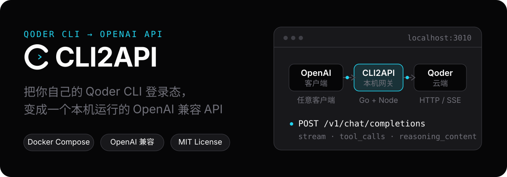
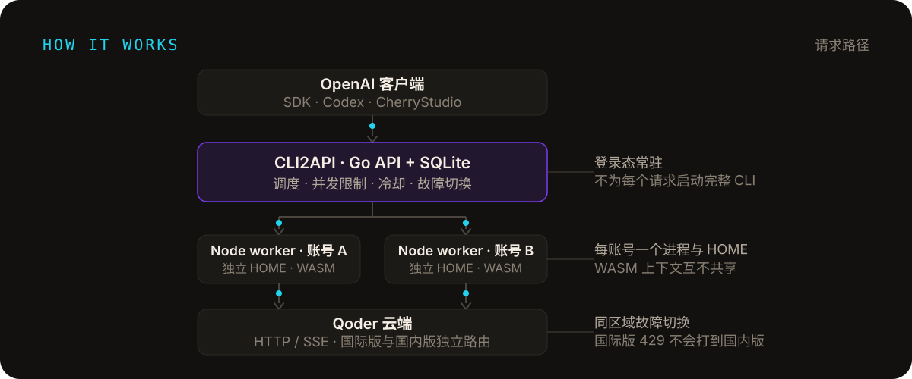
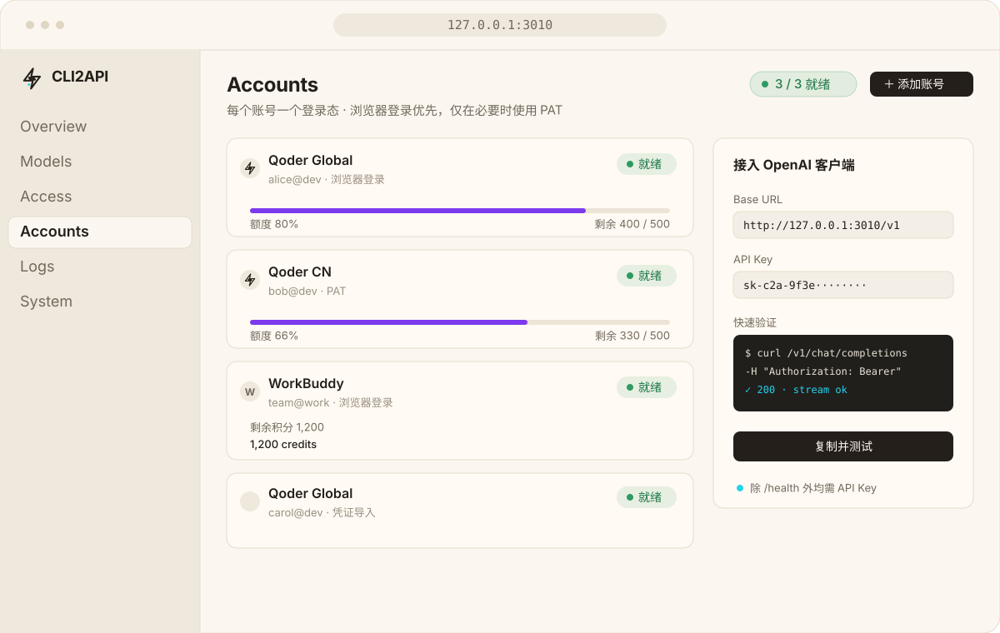

<div align="center">

<h1> CLI2API</h1>

**把你自己的登录态，变成一个本机 OpenAI 兼容 API**

接入 **Qoder（国际版 / 国内版）**、**WorkBuddy（国际版 / 国内版）**、**Trae 国内版 Work**，以及实验性的 **Devin** 和 **Command Code**。

用 Docker 部署，在 Web 控制台管理账号，再通过兼容 API 接入客户端。

[](LICENSE)
[](https://t.me/+jCjL8ou_g7Q2MzI1)

<sub>[English](README_EN.md) · [问题反馈](https://github.com/caigee-cmd/cli2api/issues) · [Telegram](https://t.me/+jCjL8ou_g7Q2MzI1)</sub>



</div>

## 功能

- **兼容接口**：Chat Completions、Responses、Anthropic Messages 和模型列表，支持流式回复与函数工具调用。
- **多账号调度**：轮询、加权轮询、顺序填满，以及可选的同供应商最早到期优先（FEFO）；保留自动选号、会话粘性、并发限制、冷却与故障切换。
- **统一控制台**：管理账号、模型、客户端密钥、代理设置，查看额度和请求日志。
- **Docker 运维**：持久化账号数据；可选安装宿主机更新器，在控制台下载更新、确认升级和回滚。

Qoder 国内版、WorkBuddy、Trae 的适配代码已实现，真账号验收仍未完成；Devin 与 Command Code 为实验性接入，不承诺生产可用。托管更新的真实升级 / 回滚验收也尚未完成。Kimi Code（中国区）已完成单账号端到端验收：设备码登录、模型发现、三种接口的对话 / 流式 / 工具调用 / 视觉，以及额度读取；多账号行为只有自动化测试覆盖。

## 快速开始

需要 Docker 和一个你自己控制的上游账号。macOS / Windows 使用 Docker Desktop；Windows 需使用 Linux containers。

```bash
git clone https://github.com/caigee-cmd/cli2api.git
cd cli2api
./scripts/start.sh        # Windows 用 scripts\start.ps1
```

1. 保存首次启动日志中打印的**管理员密钥**。
2. 打开 `http://127.0.0.1:3010`，用管理员密钥登录，在 **Accounts** 添加账号。
3. 在 **API keys** 创建客户端密钥，在 **Access** 选择模型并测试。

Docker Compose 是支持的安装与托管更新路径；源码运行用于开发。详细步骤见 [部署说明](deploy/README.md)。

## 接入客户端

在支持 OpenAI 兼容 API 的客户端中填写：

```text
Base URL: http://127.0.0.1:3010/v1
API Key:  <在 API keys 页面创建的客户端密钥>
```

模型 ID 从 **Access** 页面或 `/v1/models` 获取。默认自动选择账号，同一对话优先复用原账号。固定账号、自定义会话标识及 curl / PowerShell 示例见 [部署说明](deploy/README.md)。

## 工作方式

<p align="center">
  
</p>

Go 网关统一鉴权、调度和记录请求。Qoder 每个账号使用独立 Node 进程与 HOME；WorkBuddy、Trae、Devin、Command Code 使用 Go 进程内适配器，不为每次请求启动完整 CLI。

## 控制台

<p align="center">
  
</p>

账号、模型、接入和日志都在同一个 Web 控制台里管理：就绪状态和额度一目了然，Access 页可以直接复制 Base URL 并做一次快速验证。

在「账号」卡片直接操作 WorkBuddy、QwenWork 国内版/国际版与 Qoder 国内版、国际版的签到、自动签到开关（默认关闭），并从「更多 → 签到记录」查看历史，不另设签到中心。在「系统 → 自动签到」配置各供应商默认时间，「编辑账号」可选择跟随默认或自定义；修改默认时间会立即影响未覆盖的账号。已有 WorkBuddy 账号保留原时间，可在编辑账号时切回跟随默认。活动关闭时只记录跳过；真实账号签到验收仍待完成。QwenWork 的签到接口在客户端里存在，但生产网关尚未开放（404）：国内版按钱包日额度核对当日免费积分，国际版只能核对总额度并记录跳过原因。

## 最早到期优先（FEFO）

在「系统 → 账号调度策略」选择「最早到期优先（FEFO）」，或向 `PATCH /api/system/settings` 提交 `{"routing_strategy":"fefo"}`。默认仍是轮询，原有轮询、加权轮询和顺序填满行为不变。

- **只在同一供应商内排序**：先按供应商分组，再比较本组账号最近的积分包到期日；Qoder、WorkBuddy 等互不影响，跨供应商仍按原有轮询选择。
- **只认实际可消费的积分包到期**：跳过余额为零、已过期或到期未知的包；同一 UTC+8 自然日到期的账号公平轮询。未知到期不猜测，作为该供应商的兜底候选，只有已知到期账号都不可用时才参与。
- **额度与故障切换照旧**：额度耗尽、限流冷却、并发占满或被显式排除的账号先退出候选，恢复后自动回到排序。响应或流结束后异步刷新该账号额度并重新排序；缓存中的包自然过期也会触发额度探测。不会把订阅重置、令牌有效期或签到奖励当成积分包到期。
- **数据缺口**：目前只有 WorkBuddy 个人账号的 `get-user-resource` 返回逐包 `CycleEndTime`。Qoder 的 `quota/usage` 只有订阅月度边界（`expiresAt`），Trae、Devin、Command Code、Codex 也只有重置窗口或总额度，因此这些供应商的账号在 FEFO 下按未知日期处理。WorkBuddy 企业/共享身份，以及结果达到 100 条的未确认列表，也不会获得 FEFO 优先级。升级后尚未刷新额度的旧缓存同样按未知日期处理，启动探测或手动刷新后才会带上包元数据。

## 使用限制

- 只连接你自己的账号，不提供账号、额度或官方 API 服务。
- 兼容接口不等于完整复刻官方 API。Messages / Responses 为无状态适配，不保存服务端会话，也不执行上游专属工具。
- 图片能力取决于上游和模型，网关把上游声明的图片输入逐模型透出为 `supports_images`（`/v1/models` 与 `/api/models`）。WorkBuddy 的 DeepSeek V4 / V4.1、GLM、Kimi 等模型支持图片；Trae、Command、Zhipu 未声明图片输入。具体范围见 [部署说明](deploy/README.md)。
- 跨上游同名模型调度受系统开关、账号权限和地域约束；不是任意账号之间都能切换。
- 上游协议变化可能影响兼容性；请求日志默认不保存提示词或回复正文。

## 文档

- [部署与运维：启动步骤、环境变量、接口、托管更新](deploy/README.md)
- [变更记录](CHANGELOG.md)

## 安全

默认只向本机开放 `127.0.0.1:3010`，不要直接暴露到公网。管理员密钥可操作控制台；客户端密钥仅用于 `/v1/*`。请妥善保管密钥、账号导出文件和数据库备份，发现问题按 [SECURITY.md](SECURITY.md) 私下报告。

## 社区与贡献

讨论请加入 [Telegram 群](https://t.me/+jCjL8ou_g7Q2MzI1)。国内也可扫下方个人微信二维码联系。缺陷和功能请求请走 GitHub [Issue](https://github.com/caigee-cmd/cli2api/issues)；文档改进与 Pull Request 见 [CONTRIBUTING.md](CONTRIBUTING.md)。

<p align="center">
  
</p>

## 致谢

感谢 `workbuddy2api`、`CLIProxyAPI`、`sub2api` 等开源项目提供的思路与启发。

## 许可证

[MIT](LICENSE)。使用上游账号时，请遵守对应平台的服务条款。
