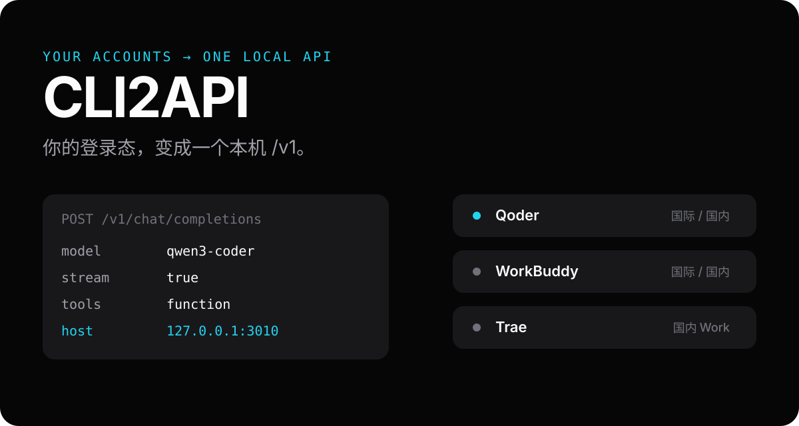
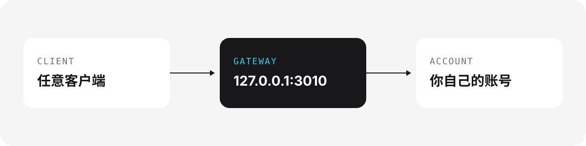
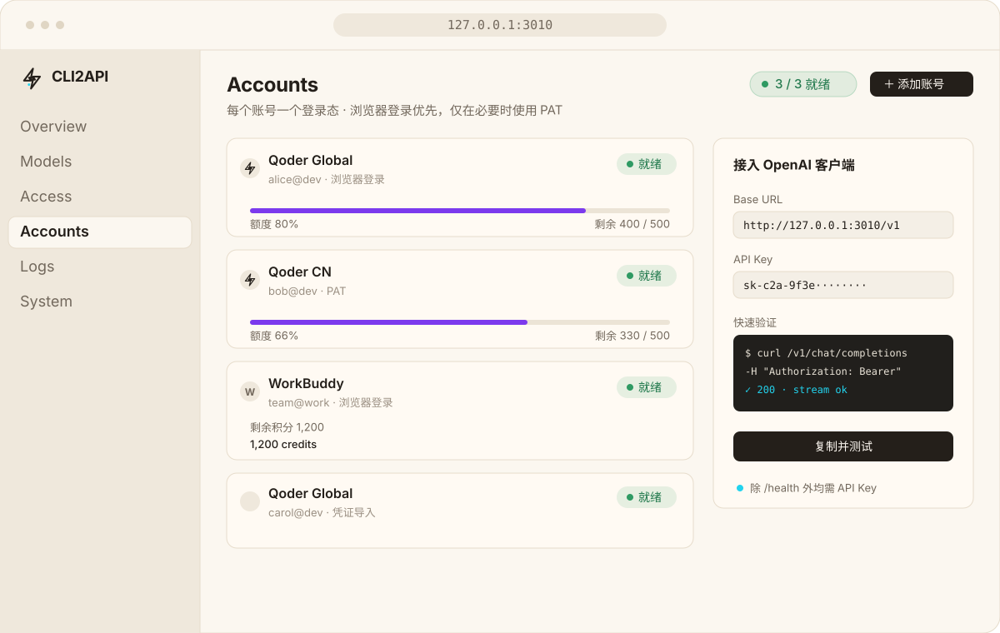

<div align="center">

<h1> CLI2API</h1>

**把你自己的登录态，变成一个本机 OpenAI 兼容 API**

[](LICENSE)
[](https://t.me/+jCjL8ou_g7Q2MzI1)

<sub>[English](README_EN.md) · [问题反馈](https://github.com/caigee-cmd/cli2api/issues) · [Telegram](https://t.me/+jCjL8ou_g7Q2MzI1)</sub>



</div>

## 赞助

CLI2API 自托管、自带账号。不想自己部署时，用赞助商的托管 Gateway。

<p>
<a href="https://caiaiu.com"><picture><source media="(prefers-color-scheme: dark)" srcset="./docs/assets/sponsors/caiai-dark.svg"></picture></a>
</p>

| 赞助商 | 是什么 | 适合谁 | 入口 |
| --- | --- | --- | --- |
| [CaiAI](https://caiaiu.com) | 预付费的 OpenAI 兼容 API Gateway。一把密钥覆盖 Claude Code、Codex、OpenCode、Cherry Studio、TRAE 等客户端，路由 GPT、Grok、GLM、Kimi 等模型，并提供用量、密钥限额与账单。 | 想直接调用模型、不自备登录态的团队 | [caiaiu.com](https://caiaiu.com) |

这里管的是你自己的账号和本机网关。CaiAI 管的是托管密钥、路由和计费。

<p>

</p>

需要 Docker，和一个你自己控制的上游账号。macOS / Windows 用 Docker Desktop；Windows 需使用 Linux containers。

```bash
git clone https://github.com/caigee-cmd/cli2api.git
cd cli2api
./scripts/start.sh        # Windows 用 scripts\start.ps1
```

1. 保存首次启动日志里的**管理员密钥**。
2. 打开 `http://127.0.0.1:3010`，用它登录，在 **Accounts** 添加账号。
3. 在 **API keys** 创建客户端密钥，到 **Access** 选一个模型并测试。

然后在任意 OpenAI 兼容客户端里填：

```text
Base URL: http://127.0.0.1:3010/v1
API Key:  <刚才创建的客户端密钥>
```

模型 ID 从 **Access** 或 `/v1/models` 获取。默认自动选号，同一对话优先复用原账号。环境变量、固定账号、托管更新见 [部署说明](deploy/README.md)。

<p>

</p>

<p>

</p>

接入 **Qoder（国际版 / 国内版）**、**WorkBuddy（国际版 / 国内版）**、**Trae 国内版 Work**。**Devin**、**Command Code**、**华为云码道 CodeArts** 是实验性接入，不承诺生产可用。

Go 网关统一鉴权、调度和记录请求。Qoder 每个账号一个独立 Node 进程和 HOME；其余供应商走进程内适配器，不为每次请求启动完整 CLI。

- **三种接口**：Chat Completions、Responses、Anthropic Messages，加上模型列表。支持流式和函数工具调用。
- **多账号**：轮询、加权轮询、顺序填满，以及可选的同供应商最早到期优先（FEFO）。自动选号、会话粘性、并发限制、冷却和故障切换都在。
- **一个控制台**：账号、模型、客户端密钥、代理、额度和请求日志。
- **Docker**：账号数据持久化。可选的宿主机更新器可以在控制台里下载、确认和回滚。

Qoder 国内版、WorkBuddy、Trae 已实现，真账号验收未完成。Kimi Code（中国区）和码道已完成单账号端到端验收；码道的额度耗尽切换，以及托管更新的真实升级 / 回滚，仍待验收。

## 控制台

<p align="center">
  
</p>

就绪状态和额度在账号卡片上。Access 页可以复制 Base URL，并做一次快速验证。WorkBuddy、QwenWork、Qoder 可以在卡片上签到；自动签到默认关闭，时间在「系统 → 自动签到」。真实账号签到验收仍待完成。

## 最早到期优先

在「系统 → 账号调度策略」里选「最早到期优先」，或提交 `{"routing_strategy":"fefo"}` 到 `PATCH /api/system/settings`。默认仍是轮询。

只在同一供应商内，按最近一笔还能用的积分包到期日排序。没有到期日的账号不猜测，只在有日期的账号都不可用时才上场。额度耗尽、冷却、并发占满的账号照旧先退出。目前只有 WorkBuddy 个人账号有逐包到期日。

<p>

</p>

- 只连接你自己的账号。这里不提供账号、额度或官方 API。
- 兼容不等于完整复刻。Messages / Responses 不保存服务端会话，也不执行上游专属工具。
- 图片取决于上游和模型，以 `supports_images` 为准。范围见 [部署说明](deploy/README.md)。
- 同名模型跨上游调度，受系统开关、账号权限和地域约束。
- 上游协议一变，兼容性就可能变。请求日志默认不存提示词和回复正文。

## 安全

默认只监听 `127.0.0.1:3010`，不要直接暴露到公网。管理员密钥管控制台，客户端密钥只用于 `/v1/*`。密钥、账号导出和数据库备份请自己保管。安全问题按 [SECURITY.md](SECURITY.md) 私下报告。

## 社区与贡献

讨论在 [Telegram 群](https://t.me/+jCjL8ou_g7Q2MzI1)。国内也可以扫下面的个人微信。缺陷和功能请求走 GitHub [Issue](https://github.com/caigee-cmd/cli2api/issues)，文档和代码见 [CONTRIBUTING.md](CONTRIBUTING.md)。变更记录在 [CHANGELOG.md](CHANGELOG.md)。

<p align="center">
  
</p>

## 致谢

感谢 `workbuddy2api`、`CLIProxyAPI`、`sub2api` 等开源项目提供的思路与启发。

## 许可证

[MIT](LICENSE)。使用上游账号时，请遵守对应平台的服务条款。
