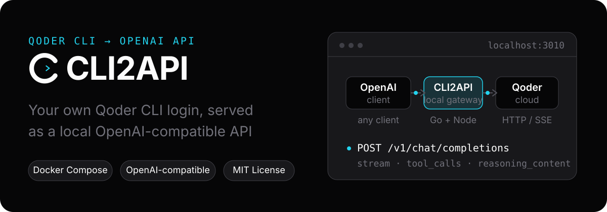
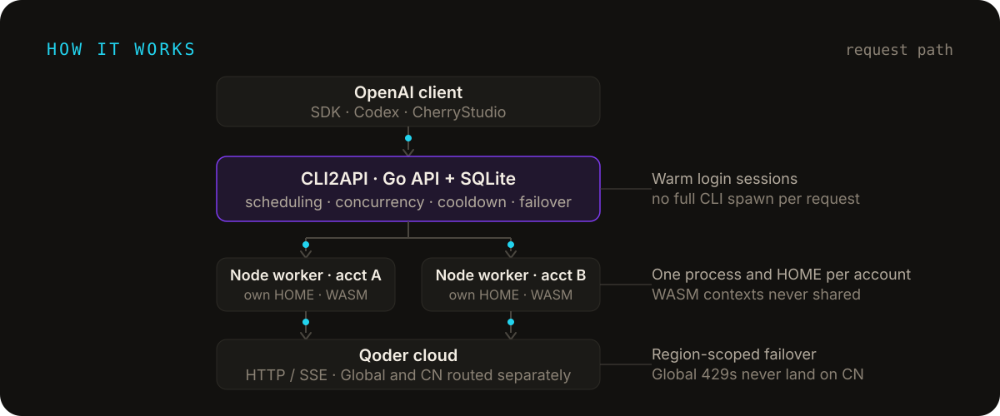
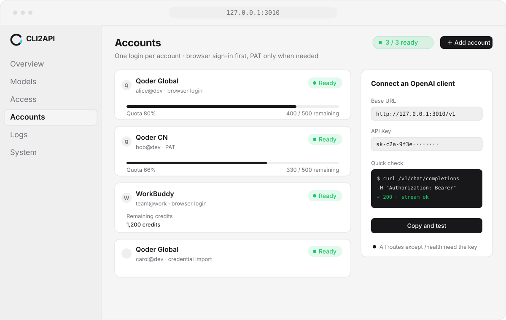

<div align="center">

<h1> CLI2API</h1>

**Turn your own logins into a local OpenAI-compatible API**

Connect **Qoder (Global / CN)**, **WorkBuddy (Global / CN)**, **Trae CN Work**, and experimental **Devin**, **Command Code**, and **Huawei Cloud CodeArts (码道)** accounts.

Deploy with Docker, manage accounts in the web console, and connect clients through compatible APIs.

[](LICENSE)
[](https://t.me/+jCjL8ou_g7Q2MzI1)

<sub>[中文](README.md) · [Issues](https://github.com/caigee-cmd/cli2api/issues) · [Telegram](https://t.me/+jCjL8ou_g7Q2MzI1)</sub>

<sub>Sponsors</sub>

<a href="https://caiaiu.com"><picture><source media="(prefers-color-scheme: dark)" srcset="./docs/assets/sponsors/caiai-dark.svg"></picture></a>



</div>

## Features

- **Compatible APIs**: Chat Completions, Responses, Anthropic Messages, and model listing, with streaming and function tools.
- **Multi-account routing**: round-robin, weighted round-robin, fill-first, and opt-in same-provider earliest-expiry-first (FEFO), with automatic selection, session affinity, concurrency limits, cooldowns, and failover.
- **Web console**: manage accounts, models, client keys, and proxies; view quotas and request logs.
- **Huawei Cloud CodeArts (experimental)**: OAuth PKCE sign-in followed by direct OpenAI-compatible calls to snap-access, with streaming, tools, and package-credit / token meters.
- **Docker operations**: persistent account data; an optional host updater lets you download, confirm, and roll back updates from the console.

Qoder CN, WorkBuddy, and Trae adapters are implemented, but live-account acceptance is still pending. Devin, Command Code, and Huawei Cloud CodeArts are experimental, not production-ready. Live upgrade and rollback acceptance is also pending. The Kimi Code CN adapter has single-account end-to-end acceptance: device-code sign-in, model discovery, chat/streaming/tools/vision on all three APIs, and quota readout; multi-account behavior is covered by automated tests only. CodeArts has single-account end-to-end acceptance: OAuth sign-in, model discovery with unusable-model removal, non-streaming and streaming Chat Completions / Anthropic Messages / Responses, tool calls, reasoning passthrough, package-credit readout, and check-in; two-account failover and session affinity have also been verified live, while quota-exhaustion failover is still pending.

## Quick start

You need Docker and an upstream account you control. Use Docker Desktop on macOS / Windows; Windows must use Linux containers.

```bash
git clone https://github.com/caigee-cmd/cli2api.git
cd cli2api
./scripts/start.sh        # Windows: scripts\start.ps1
```

1. Save the **administrator key** printed in the first-start logs.
2. Open `http://127.0.0.1:3010`, sign in with that key, and add an account in **Accounts**.
3. Create a client key in **API keys**, then choose a model and test it in **Access**.

Docker Compose is the supported install and managed-update path; source runs are for development. See the [deployment guide](deploy/README.md).

## Connect a client

In an OpenAI-compatible client, enter:

```text
Base URL: http://127.0.0.1:3010/v1
API Key:  <a client key created in API keys>
```

Get a model ID from **Access** or `/v1/models`. Routing is automatic and prefers the same account for later turns. Account pinning, session headers, and curl / PowerShell examples are in the [deployment guide](deploy/README.md).

## How it works

<p align="center">
  
</p>

The Go gateway handles authentication, routing, and request logging. Each Qoder account has its own Node process and HOME; WorkBuddy, Trae, Devin, Command Code, and CodeArts use Go in-process adapters. No full CLI is started per request.

## Console

<p align="center">
  
</p>

Accounts, models, access, and logs all live in one web console: readiness and quota are visible at a glance, and the Access page lets you copy the Base URL and run a quick check.

Account cards provide WorkBuddy, QwenWork CN/Global, Qoder CN, and Qoder Global check-in actions and automatic check-in switches (off by default), with history under More → Check-in records; no separate check-in page is needed. Set each provider's default time under System → Automatic check-in, then choose inheritance or an override in Edit account. Default changes apply to inheriting accounts immediately. Existing WorkBuddy accounts retain their previous times until switched to inheritance. Inactive campaigns are skipped. Live-account check-in acceptance is still pending. QwenWork ships a check-in API in its desktop client, but production gateways do not route it (404): CN confirms the daily free credits from the wallet balance, while Global can only report the total quota and the skip reason.

## Earliest-expiry-first (FEFO)

Select **Earliest expiry first (FEFO)** under **System → Account routing strategy**, or send `{"routing_strategy":"fefo"}` to `PATCH /api/system/settings`. Round-robin remains the default; the existing round-robin, weighted round-robin, and fill-first behavior is unchanged.

- **Rank only inside one provider.** Accounts are grouped by provider family before their nearest credit-package expiry is compared. Qoder, WorkBuddy, and other providers never compete with each other, and cross-provider selection keeps its existing rotation.
- **Use only spendable package dates.** Depleted, expired, and undated packages are skipped. Accounts expiring on the same UTC+8 calendar day rotate fairly. Missing dates are never guessed: they form that provider's fallback cohort and participate only after every dated account is unavailable.
- **Keep quota and failover semantics.** Exhausted, cooling, concurrency-saturated, or explicitly excluded accounts leave the candidate set and return to the ranking once they recover. Finishing a response or stream refreshes that account's quota asynchronously; a cached package expiring naturally also triggers a probe. Subscription resets, token lifetimes, and check-in rewards are never treated as package expiry.
- **Data gaps.** Only WorkBuddy personal accounts currently return per-package `CycleEndTime` from `get-user-resource`. Qoder's `quota/usage` exposes only the subscription cycle boundary (`expiresAt`), while Trae, Devin, Command Code, and Codex expose reset windows or totals only, so their accounts remain in the unknown-date cohort under FEFO. CodeArts reports package credits and token meters but no per-package expiry, so it is treated as unknown rather than given a fabricated date. WorkBuddy enterprise/shared identities and unconfirmed result sets capped at 100 also receive no FEFO priority. Cached quota snapshots written before this version remain undated until the boot probe or a manual refresh repopulates the package metadata.

## Limitations

- Bring your own accounts. CLI2API does not supply accounts, quotas, or an official API service.
- Compatibility is not full API parity. Messages / Responses are stateless adapters, without server-side conversations or upstream-specific tool execution.
- Image support depends on the upstream and model. The gateway surfaces each model's declared image input as `supports_images` on `/v1/models` and `/api/models`. WorkBuddy's DeepSeek V4 / V4.1, GLM, and Kimi models accept images; Trae, Command, Zhipu, and CodeArts do not declare image input. See the [deployment guide](deploy/README.md) for details.
- Cross-provider routing for shared model IDs follows system settings, key grants, and region constraints; failover is not unrestricted.
- Upstream changes can break compatibility. Request logs do not store prompt or completion bodies by default.

## Documentation

- [Deployment and operations: setup steps, environment variables, endpoints, managed updates](deploy/README.md)
- [Changelog](CHANGELOG.md)

## Security

The default deployment exposes only `127.0.0.1:3010`; do not expose it directly to the public internet. Administrator keys manage the console; client keys only access `/v1/*`. Protect keys, credential exports, and database backups. Report security issues privately as described in [SECURITY.md](SECURITY.md).

## Community & Contributing

Discussion is in the [Telegram group](https://t.me/+jCjL8ou_g7Q2MzI1). In China you can also scan the personal WeChat QR below. Bugs and feature requests go to GitHub [Issues](https://github.com/caigee-cmd/cli2api/issues); documentation improvements and pull requests are welcome — see [CONTRIBUTING.md](CONTRIBUTING.md).

<p align="center">
  
</p>

## Acknowledgements

Thanks to open-source projects including `workbuddy2api`, `CLIProxyAPI`, and `sub2api` for ideas and inspiration.

## License

[MIT](LICENSE). Follow each upstream platform's terms when using its accounts.
