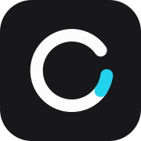
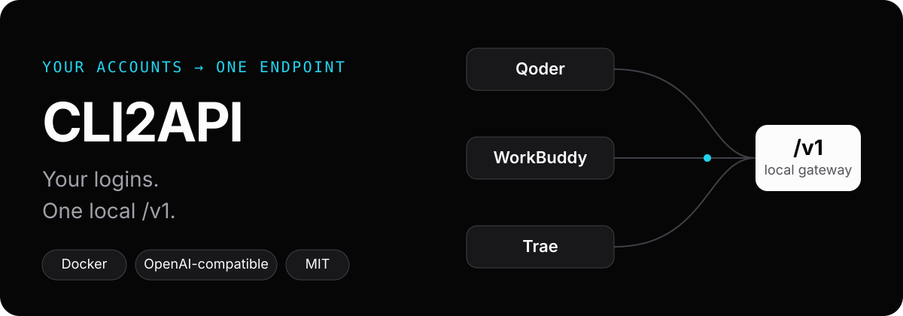
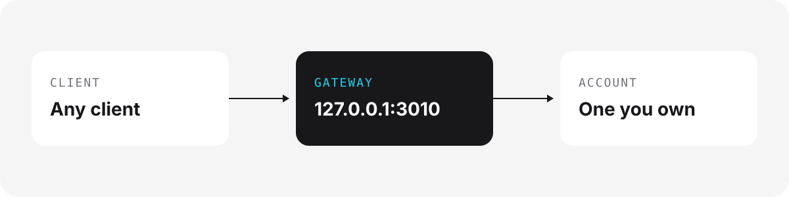
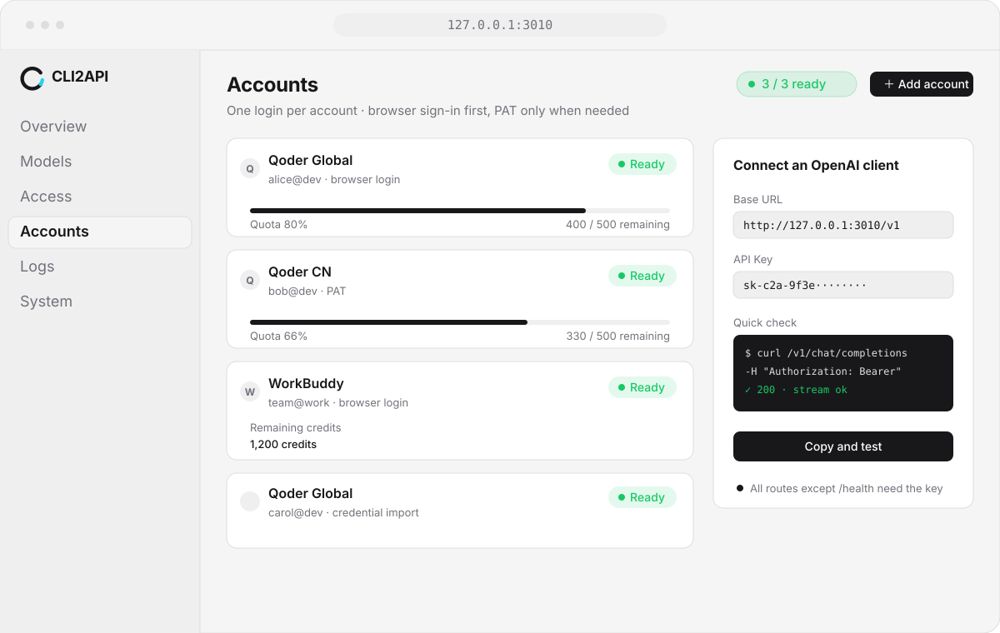

<div align="center">

<h1> CLI2API</h1>

**Turn your own logins into a local OpenAI-compatible API**

[](LICENSE)
[](https://t.me/+jCjL8ou_g7Q2MzI1)

<sub>[中文](README.md) · [Issues](https://github.com/caigee-cmd/cli2api/issues) · [Telegram](https://t.me/+jCjL8ou_g7Q2MzI1)</sub>



</div>

## Sponsors

CLI2API is self-hosted and uses accounts you already have. If you would rather not run it, the sponsor offers a hosted gateway.

<p>
<a href="https://caiaiu.com"><picture><source media="(prefers-color-scheme: dark)" srcset="./docs/assets/sponsors/caiai-dark.svg"></picture></a>
</p>

| Sponsor | What it is | Who it is for | Link |
| --- | --- | --- | --- |
| [CaiAI](https://caiaiu.com) | A prepaid OpenAI-compatible API gateway. One key covers clients such as Claude Code, Codex, OpenCode, Cherry Studio, and TRAE, routes models including GPT, Grok, GLM, and Kimi, and includes usage, key limits, and billing. | Teams that want model access without bringing their own logins | [caiaiu.com](https://caiaiu.com) |

CLI2API manages your own accounts on a local gateway. CaiAI manages hosted keys, routing, and billing.

<p>

</p>

You need Docker and an upstream account you control. Use Docker Desktop on macOS / Windows; Windows must use Linux containers.

```bash
git clone https://github.com/caigee-cmd/cli2api.git
cd cli2api
./scripts/start.sh        # Windows: scripts\start.ps1
```

1. Save the **administrator key** printed on first start.
2. Open `http://127.0.0.1:3010`, sign in, and add an account under **Accounts**.
3. Create a client key under **API keys**, then pick a model and test it under **Access**.

Point any OpenAI-compatible client at:

```text
Base URL: http://127.0.0.1:3010/v1
API Key:  <the client key you just created>
```

Model IDs come from **Access** or `/v1/models`. Routing is automatic and prefers the same account for later turns. Environment variables, account pinning, and managed updates are in the [deployment guide](deploy/README.md).

<p>

</p>

<p>

</p>

Stable support covers **Qoder (Global / CN)**, **WorkBuddy (Global / CN)**, and **Trae CN Work**. Every other provider is experimental and not a production promise: Devin, Command Code, Codex, Zhipu GLM, QwenWork (Global / CN), Kimi Code (CN), Huawei Cloud CodeArts (码道), Kiro, Muse (Meta), Doubao Work, and MiniMax Code (Global / CN).

The Go gateway handles authentication, routing, and request logging. PAT-backed Qoder accounts talk to the upstream in-process. Qoder accounts that still use the legacy CLI credential keep one Node process and HOME each. Other providers use in-process adapters, so no full CLI starts per request.

- **Three APIs**: Chat Completions, Responses, and Anthropic Messages, plus model listing. Streaming and function tools included.
- **Many accounts**: round-robin, weighted round-robin, fill-first, least/most remaining quota first, and opt-in same-provider earliest-expiry-first (FEFO). Automatic selection, session affinity, concurrency limits, cooldowns, and failover stay on.
- **One console**: accounts, models, client keys, proxies, quotas, and request logs.
- **Docker**: account data persists. An optional host updater downloads, confirms, and rolls back from the console.

Qoder CN, WorkBuddy, and Trae are implemented; live-account acceptance is still pending. Kimi Code CN and CodeArts have single-account end-to-end acceptance. CodeArts quota-exhaustion failover, and live upgrade / rollback, are still pending. Experimental providers are not promised individually; their state is whatever the code currently does.

## Console

<p align="center">
  
</p>

Readiness and quota sit on the account card. Access copies the Base URL and runs a quick check. Check-in is declared per provider; today that is WorkBuddy CN, QwenWork, Qoder, Trae, MiniMax Code, CodeArts, and Doubao Work, each with a manual check-in on the card. Automatic check-in is enabled per account and off by default, with the default time per provider under System → Automatic check-in. Live-account check-in acceptance is still pending.

## Earliest expiry first

Choose **Earliest expiry first (FEFO)** under **System → Account routing strategy**, or send `{"routing_strategy":"fefo"}` to `PATCH /api/system/settings`. Round-robin stays the default.

Accounts are ranked only inside one provider, by the nearest credit package that can still be spent. Missing dates are never guessed, and those accounts join only after every dated account is unavailable. Exhausted, cooling, and concurrency-saturated accounts still drop out first. Only WorkBuddy personal accounts currently expose a per-package expiry.

## Remaining quota first

Choose **Least remaining quota first** or **Most remaining quota first** under **System → Account routing strategy**, or send `{"routing_strategy":"least-quota-first"}` / `{"routing_strategy":"most-quota-first"}` to `PATCH /api/system/settings`. Aggregation model pools support the same strategy names.

Accounts are ranked by remaining quota ratio: `remaining / total` is preferred, and `100 - percentage` is used when no total exists. Raw remaining values are not comparable across providers with different units, so only ratios are used; accounts with unknown quota sort last.

<p>

</p>

- Bring your own accounts. CLI2API does not supply accounts, quotas, or an official API.
- Compatibility is not full parity. Messages / Responses keep no server-side conversation and run no upstream-specific tools.
- Images depend on the upstream and the model, exposed as `supports_images`. What each provider currently supports is in the [deployment guide](deploy/README.md).
- One model ID routes across upstreams by default, and a system setting turns that off. Key grants and region constraints still apply.
- An upstream protocol change can break compatibility. Request logs omit prompt and completion bodies by default.

## Security

The default listen address is `127.0.0.1:3010`. Do not expose it directly to the public internet. Administrator keys run the console; client keys only reach `/v1/*`. Keep keys, credential exports, and database backups to yourself. Report security issues privately, as [SECURITY.md](SECURITY.md) describes.

## Community & contributing

Discussion is in the [Telegram group](https://t.me/+jCjL8ou_g7Q2MzI1). In China you can also scan the personal WeChat QR below. Bugs and feature requests go to GitHub [Issues](https://github.com/caigee-cmd/cli2api/issues). Docs and code: [CONTRIBUTING.md](CONTRIBUTING.md). History: [CHANGELOG.md](CHANGELOG.md).

<p align="center">
  
</p>

## Acknowledgements

Thanks to open-source projects including `workbuddy2api`, `CLIProxyAPI`, and `sub2api` for ideas and inspiration.

## License

[MIT](LICENSE). Follow each upstream platform's terms when using its accounts.
